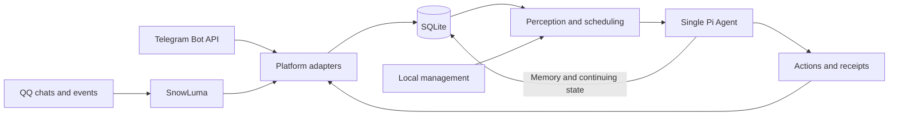

# Qiuyue Digital Life

A digital life with a persistent identity and memory, built with Pi Agent. Platform adapters expose complete native APIs as tools; one Agent observes QQ or Telegram and decides when to participate, act, or stay silent.

English | [简体中文](README.zh.md)

## What it does

- **One life across conversations.** A single Agent perceives group chats, private chats, and other events while keeping a unified identity and memory.
- **Continuity over time.** Experiences, relationships, ongoing activities, and action outcomes are stored in SQLite and restored after a restart.
- **Independent participation.** The Agent chooses whether to respond and can pursue its own activities when autonomous life is enabled.
- **Local control.** Use the terminal to inspect status and memories, pause or resume the Agent, and configure its available actions.

## Platform adapters

Use named SnowLuma and Telegram adapters together, or run Telegram without a SnowLuma service or catalog. All permitted native APIs are independently callable by the same Agent. Existing QQ configuration remains compatible. See [configuration, migration, coverage, and the adapter SDK](docs/platform-adapters.md).

## Quick start

### 1. Prepare the environment

The project's original code is MIT-licensed. The SnowLuma adapter uses the official SDK as an npm dependency; the SDK and API catalog retain their upstream licenses. Users install and run SnowLuma separately. See [Third-party licensing](THIRD_PARTY_NOTICES.md) for sources and distribution terms.

Install Node.js **24.22.1** (specified in [`.nvmrc`](.nvmrc)), then install dependencies:

```bash
nvm install
nvm use
npm ci
npm run sync:snowluma
```

The sync command prepares the pinned API catalog and its license in `.qiuyue-cache/snowluma/`, outside Git. Run it again after changing the SDK or source version. Development commands, tests, and the compiled program read this local catalog; `QIUYUE_SNOWLUMA_CATALOG` can name a separately prepared catalog. Build output does not include it.

Start and log in to [SnowLuma](https://snowluma.github.io/en/docs/sdk) separately, and enable its forward OneBot WebSocket service. You also need credentials for a model that supports image input.

### 2. Configure your digital life

```bash
cp config.example.json config.json
cp persona.example.md persona.md
install -m 600 credentials.example.json credentials.json
npm run dev -- models openai
```

Replace `openai` with your provider when listing its models. Then edit:

- **`config.json`:** Set the SnowLuma address, `snowluma.selfId` to the logged-in QQ account, and `model.provider` and `model.id` to an image-capable model. Change `personaFile` to `persona.md`. Set `snowluma.groups` to the groups whose history should be checked after connection or recovery; it can be empty and does not restrict live events.
- **`model.thinkingLevel` in `config.json` (optional):** How much a reasoning model thinks before each turn: `off` (the default), `minimal`, `low`, `medium`, `high`, `xhigh`, or `max`. A custom model also needs `model.reasoning` set to `true`. `model.compat.thinkingFormat` decides how the level is sent; use the format your endpoint accepts, since a gateway may reject another. With the OpenAI format, `off` sends nothing and leaves the model at its own default, so use `minimal` for the least thinking.
- **`embedding` in `config.json` (optional):** To let the digital life recall memories by what people are talking about, set `enabled` to `true` and point `baseUrl` and `model` at an OpenAI-compatible embeddings endpoint. Every threshold depends on the model: `threshold` (what messages call to mind), `searchThreshold` (the few words of a deliberate `recall`, which score lower), and `stickerThreshold` (saved stickers whose descriptions fit what is said, at most `stickerLimit` of them) were calibrated at `0.65`, `0.55`, and `0.65` for `qwen3-vl-embedding`, and other models need their own values. List in `selfNames` the names people call the digital life, so a message is not matched to every memory that mentions it. Without embedding, thoughts recall nothing on their own, and `recall` searches by exact words only.
- **`drawing` in `config.json` (optional):** To let the digital life generate images with `imagen`, including photorealistic photos, illustrations, stickers, and diagrams, set `enabled` to `true` and point `baseUrl` and `model` at an OpenAI-compatible `/images/generations` endpoint, such as a gateway serving `gpt-image-2.5`, with its credential named by `apiKeyEnv`. Generation takes half a minute or more, so an image comes back to the digital life as an observation when it is done, and requests give up after `timeoutMs`. Generated images are kept in `dir` (`data/drawings` beside the configuration by default) long term in the gallery, independently of chat-memory retention. There is no limit on how often it generates images; watch the endpoint's quota.
- **`life` in `config.json`:** `enabled` turns autonomous life on at first start, and `allowFiction` permits fictional daily life. While autonomous life is on, `freeTime` offers a life wake when the chats have been quiet for a stretch between `quietMinMs` and `quietMaxMs`, at least `gapMs` from any other life wake and at most `perDay` a day. The digital life holds it back by marking rest on the activity it will wake for.
- **`persona.md`:** Describe the digital life's identity and personality.
- **`credentials.json`:** Under `credentials`, set `MODEL_API_KEY` and, if required by SnowLuma, `SNOWLUMA_TOKEN`; set `DEEPSEEK_API_KEY` for web search and `WEBUI_TOKEN` for the management page. Keep `version` and `changes` as in the example. `credentialsFile` defaults to `credentials.json` beside the configuration; set an absolute path to keep it outside the checkout. The file is plaintext, protected by `0600` permissions. External environment variables take precedence, followed by this file, then legacy `.env`; an empty external variable or a `null` file entry disables that credential without falling back. The existing `apiKeyEnv`, `tokenEnv`, and `searchKeyEnv` settings name credentials in any of these sources. Set `uiLanguage` to `zh` in `config.json` for Chinese, and restart the daemon and viewers after changing it.

> **Before starting:** The example allows all SnowLuma APIs and sets no limits on model calls or actions. Adjust `snowluma.tools` and `limits` for your setup. Autonomous life is disabled by default; it can be enabled separately.

### 3. Start and inspect

```bash
npm run dev -- validate --config config.json
npm run build
npm start -- run --config config.json
```

Validation checks configuration, model, and credentials without connecting to QQ. In another terminal, open the live view:

```bash
npm start -- tui --config config.json
```

Exiting the live view does not stop the daemon.

The live view puts conversations first: received messages and external actions remain visible after a run ends, while tool activity and model output expand on demand. Model output is labeled “not sent to QQ”; message actions distinguish sent, awaiting receipt, failed, and unknown outcomes. Long messages preview eight lines and expand to the full text. Connection and pause status stay at the top; current activity and context usage stay at the bottom. Accents adapt to the terminal's light or dark background. Received events waiting to enter the model appear separately. Two minutes without output produces a “Waiting longer than usual” hint, not a confirmed-stall diagnosis.

Use `Alt↑↓` to select records, `Tab` to expand details, and `/details` to view full records and streaming telemetry. `/filter errors` shows failures and unknown outcomes; `/filter all` clears the filter. Type `/` to browse management commands, use `↑↓` to select and `Tab` to fill the input, then press Enter to execute. `Esc` dismisses suggestions without clearing the input. `/status` shows call and action counts; `Esc` closes status or help. Rebuild and reopen the TUI to use the new layout; an updated daemon additionally supplies structured sender and action-kind fields.

## Management

Bilibili and Xiaohongshu can be part of autonomous life: discover and read content, receive Xiaohongshu text and images together, favorite items on the platform account, and resume reading later. Both are optional user plugins, built and installed separately from the core. They are off by default and can be configured and reloaded independently on the capabilities page. Bilibili favorites and some reads need a logged-in Cookie; Xiaohongshu needs a logged-in `xiaohongshu-mcp` service. See [online life setup and scope](docs/online-life.md).

Use these commands with `npm start -- <command> --config config.json` after building:

| Command | Purpose |
| --- | --- |
| `status` / `logs` | Inspect continuing state or logs |
| `pause` / `resume` | Pause or resume the digital life |
| `life on` / `life off` | Enable or disable autonomous life |
| `memory search <query>` | Search memories and personal notes |
| `memory show <ID>` | Inspect a memory and its sources |

Run `npm start -- help` for all commands, including memory correction and deletion. Restart the daemon after changing core configuration.

### Management page

```bash
npm start -- webui --config config.json
```

A web page for the same work: live status and timeline, pause and life switches, configuration, plugins and QQ interface permissions, the persona file and the digital life's own development, the system prompt, model providers, and the separately stored credentials. It runs apart from the daemon, so it stays up while the daemon restarts and still opens when the configuration no longer loads.

- **Access:** it listens on `webui.host`:`webui.port` (default `127.0.0.1:8848`); from another machine, use an SSH tunnel such as `ssh -L 8848:127.0.0.1:8848 <server>`. Use the value of the credential named by `webui.tokenEnv` (default `WEBUI_TOKEN`) in the login form. The credential name itself is not a token. If no token is configured, each start prints a sign-in link in the terminal or service log; use the latest link.
- **Appearance:** six main sections organize activity, configuration, capabilities, persona, prompts, and models. The top-right Appearance control offers six accent presets, custom HEX colors, and light/dark/system modes. Preferences are saved in this browser and apply immediately without restarting. Duration fields accept milliseconds, seconds, minutes, or hours and save as milliseconds.
- **Saving:** every save checks the configuration the way the daemon loads it, refuses a file changed elsewhere since the page read it, and keeps earlier configuration, persona, and prompt versions under `data/webui/history`. Credentials have no value history; only the names, times, and kinds of the latest 100 changes are recorded in the credential file. Plugin settings can be applied with Reload on the capabilities page; core settings take effect when the daemon restarts. The page reports the running plugin versions and whether a reload renews working context; changing the persona, system prompt, model, or tool set starts a fresh one.
- **System prompt:** saving it writes `system-prompt.md` beside `config.json` (outside git) and sets `systemPromptFile`; without that setting the built-in prompt is used. The page warns when the built-in prompt has changed since your file was saved.
- **Restarts:** set `webui.service` to the daemon's systemd user unit, such as `qiuyue-digital-life.service`, to start, stop, and restart it from the page. A restart can wait until no thought or memory review is under way.
- **Credentials:** the page shows masked values and their sources, refuses edits to externally injected values, and saves new values only to `credentialsFile`. Connection tests read the latest files with the same precedence as the daemon. Reload the affected plugins to apply their credentials; core consumers still require a daemon restart, and changing the login token requires a management-page restart. Disabling a credential prevents old `.env` values from becoming active again. After updating both the daemon and management page to this version, migrate an existing installation: first set `credentialsFile` to the intended destination, then run `npm run dev -- credentials migrate --config config.json`. This copies legacy credentials before removing their definitions from `.env`, preserves ordinary settings, and deletes the old `history/env` directory. It can be retried safely; it never prints credential values.
- **Providers:** the page keeps provider endpoints in `data/webui/providers.json`; choosing one copies its address, API, and key variable into `model`, `embedding`, or `drawing`. The daemon reads only `config.json`.

## How it works



The TypeScript service keeps receiving events while the Agent thinks. Named adapters expose all permitted APIs as `instance__operation` tools. Legacy SnowLuma APIs are exposed with their original names and parameters; `snowluma.tools` controls which are available. The Agent can search the catalog with `search_snowluma_tools` and retrieve details with `load_snowluma_tools`.

System instructions use [`src/prompts/system.md`](src/prompts/system.md) for legacy QQ configuration and [`src/prompts/platform.md`](src/prompts/platform.md) for named adapters, maintained with the runtime and separate from the operator's `personaFile`. They are read once at startup; `npm run build` copies them into `dist`. After editing them, rebuild and restart the daemon (development runs only need a restart).

QQ native tools, image generation (`imagen`), web search, webpage reading, Qzone card sharing, saved-sticker enhancement, and QQ system faces are plugins. Plugins can supply tools or enhance existing ones, with observation hints, background work, and pictures as needed. Existing `drawing` and `web` configuration continues to work; optional switches in `config.json` control each plugin independently:

```json
"plugins": {
  "web-search": false,
  "web-reader": true,
  "qzone-share": true,
  "qq-stickers": true,
  "qq-faces": true,
  "snowluma-tools": true
}
```

Omitted switches preserve existing behavior. The `drawing` plugin also requires `drawing.enabled`; search and reading require `web.enabled`. Sharing still follows `snowluma.tools` permissions. Save settings, then use `npm run dev -- plugins reload all --config config.json` or Reload on the capabilities page. To add a user plugin, place its `index.mjs` in `plugins/<id>/` beside the configuration and reload that ID. `npm run dev -- plugins list` shows loaded versions and pending changes. See [Plugin development](docs/plugins.md) and the [clock example](examples/plugins/clock/index.mjs) for the public interface and lifecycle rules.

`qq-stickers` defaults on. It adds descriptions during saves, recognizes already saved images, and suggests stickers that fit a conversation. Suggestions reuse `embedding` message vectors and retain the `embedding.stickerThreshold` and `embedding.stickerLimit` settings; other enhancements work without embedding. Setting it to `false` stops these enhancements and collection indexing. Native save, describe, delete, and send interfaces remain available according to permissions, and existing collection records and vectors are retained.

`qq-faces` defaults on. It supplies `view_face`, system face names, picture caching, and automatic viewing once per face per thought. These pictures follow chat images and share the image and context limits. Setting it to `false` removes name enhancement, automatic pictures, and `view_face`; records still show native IDs, and native reaction and send interfaces remain available according to permissions. The stored directory is retained.

`snowluma-tools` defaults on. It registers native QQ tools, their search and detailed instructions, and life activities such as Qzone, group albums, check-ins, and profile changes. Native availability still follows `snowluma.tools.allow` and `deny`. Setting it to `false` removes those tools and activity hints; the QQ connection, continuous perception, recovery, and memory keep running. Other plugins follow their own switches and native permissions. Saved-sticker send suggestions also stop while the native tools are off.

For the domain vocabulary and design decisions, see the [glossary](GLOSSARY.md) and [architecture decision records](docs/adr/).

## License

[MIT](LICENSE) for this project's original code. The SnowLuma SDK and locally prepared API catalog retain their [upstream licenses](THIRD_PARTY_NOTICES.md).

### Gallery

The management page's Gallery browses generated images with search, dates, origins, tags, favorites, archives, downloads and deletion. Successful generation saves the original and provenance regardless of sharing outcomes. The default-on built-in `gallery` plugin works even when new generation is disabled. The model uses `search_drawings`, `view_drawing` and `update_drawing`, then reuses the permanent `drawing:<uuid>` through existing message, Qzone and sticker tools. Prompts remain separate from observed descriptions. Semantic search reuses the embedding source and falls back to keywords if unavailable.

The first upgraded start imports existing files and surviving drawing events without inventing missing details; already deleted originals cannot be recovered. Archiving is reversible; explicit deletion permanently removes the original, thumbnail and search index, retaining a historical deletion marker. Browsing and downloading work with the daemon stopped; edits require the running daemon and gallery plugin. `plugins.gallery: false` disables tools and indexing without deleting works. Built-in source changes require one rebuild/restart; subsequent switch changes use `plugins reload gallery`.
