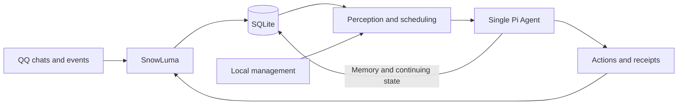

# Qiuyue Digital Life

A digital life with a persistent identity and memory, built with Pi Agent. It observes QQ chats through SnowLuma and decides when to participate, act, or stay silent.

English | [简体中文](README.zh.md)

## What it does

- **One life across conversations.** A single Agent perceives group chats, private chats, and other events while keeping a unified identity and memory.
- **Continuity over time.** Experiences, relationships, ongoing activities, and action outcomes are stored in SQLite and restored after a restart.
- **Independent participation.** The Agent chooses whether to respond and can pursue its own activities when autonomous life is enabled.
- **Local control.** Use the terminal to inspect status and memories, pause or resume the Agent, and configure its available actions.

## Quick start

### 1. Prepare the environment

Install Node.js **24.22.1** (specified in [`.nvmrc`](.nvmrc)), then install dependencies:

```bash
nvm install
nvm use
npm ci
```

Start and log in to [SnowLuma](https://snowluma.github.io/en/docs/sdk) separately, and enable its forward OneBot WebSocket service. You also need credentials for a model that supports image input.

### 2. Configure your digital life

```bash
cp config.example.json config.json
cp persona.example.md persona.md
cp .env.example .env
npm run dev -- models openai
```

Replace `openai` with your provider when listing its models. Then edit:

- **`config.json`:** Set the SnowLuma address, `snowluma.selfId` to the logged-in QQ account, and `model.provider` and `model.id` to an image-capable model. Change `personaFile` to `persona.md`. Set `snowluma.groups` to the groups whose history should be checked after connection or recovery; it can be empty and does not restrict live events.
- **`embedding` in `config.json` (optional):** To let the digital life recall memories by what people are talking about, set `enabled` to `true` and point `baseUrl` and `model` at an OpenAI-compatible embeddings endpoint. Both thresholds depend on the model: `threshold` (what messages call to mind) and `searchThreshold` (the few words of a deliberate `recall`, which score lower) were calibrated at `0.65` and `0.55` for `qwen3-vl-embedding`, and other models need their own values. List in `selfNames` the names people call the digital life, so a message is not matched to every memory that mentions it. Without embedding, thoughts recall nothing on their own, and `recall` searches by exact words only.
- **`persona.md`:** Describe the digital life's identity and personality.
- **`.env`:** Set `MODEL_API_KEY` and, if required by SnowLuma, `SNOWLUMA_TOKEN`. Set `DEEPSEEK_API_KEY` if you want web search. Set `QIUYUE_UI_LANGUAGE=zh` for Chinese; use the same language for the daemon and viewers, and restart the daemon after changing it.

> **Before starting:** The example allows all SnowLuma APIs and sets no limits on model calls or actions. Adjust `snowluma.tools` and `limits` for your setup. Autonomous life is disabled by default; it can be enabled separately.

### 3. Start and inspect

```bash
npm run dev -- validate --config config.json
npm run build
npm start -- run --config config.json
```

Validation checks configuration, model, and credentials without connecting to QQ. In another terminal, open the live view:

```bash
npm start -- tui --config config.json
```

Exiting the live view does not stop the daemon.

## Management

Use these commands with `npm start -- <command> --config config.json` after building:

| Command | Purpose |
| --- | --- |
| `status` / `logs` | Inspect continuing state or logs |
| `pause` / `resume` | Pause or resume the digital life |
| `life on` / `life off` | Enable or disable autonomous life |
| `memory search <query>` | Search memories and personal notes |
| `memory show <ID>` | Inspect a memory and its sources |

Run `npm start -- help` for all commands, including memory correction and deletion. Restart the daemon after changing core configuration.

## How it works



The TypeScript service keeps receiving events while the Agent thinks. Enabled SnowLuma APIs are exposed with their original names and parameters; `snowluma.tools` controls which are available. The Agent can search the catalog with `search_snowluma_tools` and retrieve details with `load_snowluma_tools`.

For the domain vocabulary and design decisions, see the [glossary](GLOSSARY.md) and [architecture decision records](docs/adr/).

## License

[MIT](LICENSE)
