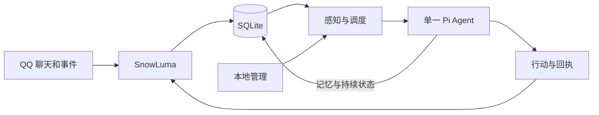

# 秋月·数字生命

基于 Pi Agent 构建的数字生命，拥有持续的人格与记忆。它通过 SnowLuma 感知 QQ 聊天，自主决定何时参与、行动或保持沉默。

[English](README.md) | 简体中文

## 它能做什么

- **一个主体，多种对话。** 同一个 Agent 感知群聊、私聊等事件，保持统一的身份和记忆。
- **持续成长。** 经历、关系、正在进行的活动和行动结果保存在 SQLite 中，重启后可以恢复。
- **自主参与。** Agent 自己决定是否回应；开启自主生活后，还可以主动安排自己的活动。
- **本地管理。** 通过终端查看状态和记忆、暂停或恢复 Agent，并配置它可以使用的行动。

## 快速开始

### 1. 准备环境

安装 Node.js **24.22.1**（见 [`.nvmrc`](.nvmrc)），然后安装依赖：

```bash
nvm install
nvm use
npm ci
```

另行启动并登录 [SnowLuma](https://snowluma.github.io/en/docs/sdk)，启用正向 OneBot WebSocket 服务。你还需要支持图片输入的模型及其凭据。

### 2. 配置数字生命

```bash
cp config.example.json config.json
cp persona.example.md persona.md
cp .env.example .env
npm run dev -- models openai
```

查看其他服务商的模型时，将 `openai` 替换为对应的服务商名称。然后编辑：

- **`config.json`：** 设置 SnowLuma 地址，将 `snowluma.selfId` 设为已登录的 QQ 账号，并将 `model.provider` 和 `model.id` 设为支持图片输入的模型。将 `personaFile` 改为 `persona.md`。`snowluma.groups` 指定连接或恢复时需要补查历史消息的群，可为空，不限制实时事件的接收范围。
- **`config.json` 中的 `embedding`（可选）：** 如需让数字生命按大家正在聊的内容想起记忆，将 `enabled` 设为 `true`，并把 `baseUrl` 和 `model` 指向兼容 OpenAI 的 embeddings 接口。两个阈值都取决于模型：`threshold`（消息让它想起什么）和 `searchThreshold`（主动 `recall` 时的几个关键词，得分通常更低）分别按 `qwen3-vl-embedding` 校准为 `0.65` 和 `0.55`，其他模型需要自行校准。在 `selfNames` 中列出别人对数字生命的称呼，避免一条消息因为提到它就匹配上所有提到它的记忆。不启用时，思考不会自动想起记忆，主动调用 `recall` 只按原词检索。
- **`config.json` 中的 `life`：** `enabled` 决定首次启动时是否开启自主生活，`allowFiction` 允许虚构日常。自主生活开启时，`freeTime` 会在聊天安静一段时间（每次在 `quietMinMs` 到 `quietMaxMs` 之间随机）后提供一次 life wake，与其他 life wake 至少相隔 `gapMs`，每天最多 `perDay` 次。数字生命在安排醒来要做的活动时标记 rest，就能让它在那之前不来。
- **`persona.md`：** 描述数字生命的身份和人格。
- **`.env`：** 填写 `MODEL_API_KEY`，以及 SnowLuma 服务端需要的 `SNOWLUMA_TOKEN`。如需联网搜索，可填写 `DEEPSEEK_API_KEY`。设置 `QIUYUE_UI_LANGUAGE=zh` 可切换中文；常驻进程和查看终端应使用相同语言，修改后需重启常驻进程。

> **启动前请注意：** 示例配置开放了全部 SnowLuma 接口，且不限制模型调用和行动次数。请根据需要调整 `snowluma.tools` 和 `limits`。自主生活默认关闭，可单独开启。

### 3. 启动与查看

```bash
npm run dev -- validate --config config.json
npm run build
npm start -- run --config config.json
```

校验会检查配置、模型和凭据，不会连接 QQ。另开一个终端，进入实时界面：

```bash
npm start -- tui --config config.json
```

退出实时界面不会停止常驻进程。

## 日常管理

构建后，使用 `npm start -- <命令> --config config.json` 执行以下命令：

| 命令 | 用途 |
| --- | --- |
| `status` / `logs` | 查看持续状态或运行记录 |
| `pause` / `resume` | 暂停或恢复数字生命 |
| `life on` / `life off` | 开启或关闭自主生活 |
| `memory search <查询>` | 搜索记忆和个人笔记 |
| `memory show <ID>` | 查看记忆及其来源 |

执行 `npm start -- help` 可查看全部命令，包括记忆修正和删除。修改核心配置后需重启常驻进程。

## 工作原理



TypeScript 服务在 Agent 思考期间持续接收事件。已开放的 SnowLuma 接口以原始名称和参数提供给 Agent，可用范围由 `snowluma.tools` 控制。Agent 可以使用 `search_snowluma_tools` 搜索接口，并通过 `load_snowluma_tools` 查看详细用法。

领域术语和设计决定见[术语表](GLOSSARY.md)与[架构决策记录](docs/adr/)。

## 许可证

[MIT](LICENSE)
