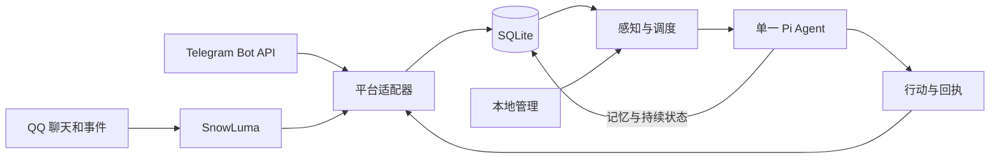

# 秋月·数字生命

基于 Pi Agent 构建的数字生命，拥有持续的人格与记忆。平台适配器将完整原生接口暴露为工具；同一个 Agent 感知 QQ、Telegram 等环境，自主决定何时参与、行动或保持沉默。

[English](README.md) | 简体中文

## 它是什么

一个常驻本地、拥有持续人格与记忆的数字生命：

- **单一灵魂：** 跨不同平台、群聊与私聊共享同一个身份、记忆与正在进行的活动，在所有对话中保持完整统一的人格。
- **自主社交：** 将收到的消息视为环境感知，自己决定搭话、贴表情、发图或保持沉默；正在回复时若对方追发新消息，可即时打断重想。
- **真实成长：** 在运营者给定的人设基础上，通过独立复盘从真实互动证据中习得群风气、表达习惯与人际印象，避免自我复读导致的幻觉强化。
- **个人生活：** 拥有跨天推进的日常事项、空闲时的线上冲浪（社交动态、长短视频与图文社区、网页搜索、绘画作品库）以及自主安排的睡眠与休息。
- **原生交互：** 通过平台适配器将完整原生 API 按权限暴露给同一个 Agent，配合系统表情看图、收藏表情语义联想、卡片分享等可热重载插件，像真实用户一样使用平台功能。
- **本地可控：** 社交发言与运行管理分离；提供实时 TUI 与独立于主进程的 WebUI，支持主思考/复盘/压缩模型分离配置与记忆溯源清理。

## 快速开始

以下以通过 SnowLuma 接入 QQ 为例。Telegram 和多账号配置见[平台适配器](docs/platform-adapters.md)；已有安装请先按[停机迁移说明](docs/platform-adapters.md#offline-upgrade)升级，再启动新版。

### 1. 准备环境

使用 [`.nvmrc`](.nvmrc) 指定的 Node.js 版本。另行启动并登录 [SnowLuma](https://snowluma.github.io/en/docs/sdk)，启用正向 OneBot WebSocket 服务，并准备支持图片输入的模型及其凭据。

```bash
nvm install
nvm use
npm ci
npm run sync:snowluma
```

### 2. 配置

```bash
cp config.example.json config.json
cp persona.example.md persona.md
install -m 600 credentials.example.json credentials.json
npm run dev -- models openai
```

查看其他服务商的模型时，将 `openai` 替换为对应名称，然后编辑：

- **`config.json`：** 设置 `adapters[0].url`，将 `adapters[0].accountId` 设为已登录 QQ 账号的十进制字符串，填写 `model.provider` / `model.id`，将 `personaFile` 改为 `persona.md`。`adapters[0].groups` 指定需要补查历史的群，可为空，不限制实时事件。中文界面可设置 `uiLanguage: "zh"`。
- **`persona.md`：** 描述数字生命的身份、性格与初始偏好。
- **`credentials.json`：** 在 `credentials` 中填写凭据值，保留 `version` 和 `changes`：模型用 `MODEL_API_KEY`，SnowLuma 按需填写 `SNOWLUMA_TOKEN`，网页搜索用 `DEEPSEEK_API_KEY`，管理网页登录可设置 `WEBUI_TOKEN`。外部环境变量优先于凭据文件，程序不读取 `.env`。

> 示例配置开放了全部 SnowLuma 接口，且不限制模型调用与行动次数。启动前请按需调整 `adapters[0].tools` 和 `limits`。自主生活默认关闭。

独立模型、语义记忆、图像生成与自主生活等可选配置见[使用指南](docs/usage.zh.md)。

### 3. 启动与管理

```bash
npm run dev -- validate --config config.json
npm run build
npm start -- run --config config.json
```

校验会检查配置、模型和凭据，不会连接 QQ。另开终端，选择一种管理界面：

```bash
npm start -- tui --config config.json
# 或启动管理网页：
npm start -- webui --config config.json
```

管理网页默认位于 `http://127.0.0.1:8848`。使用 `WEBUI_TOKEN` 的值登录；未配置时，使用启动日志中打印的临时令牌。退出管理界面不会停止常驻进程。

执行 `npm start -- help` 查看 `status`、`pause`、`resume` 和记忆管理等命令。修改核心配置后需重启常驻进程；日常操作见[使用指南](docs/usage.zh.md)。

## 工作原理



TypeScript 服务在 Agent 思考期间持续接收事件。具名适配器按 `实例名__原生接口名` 暴露所有已开放接口，原生参数保持不变；可用范围由各账号的 `tools` 控制，接口目录可在运行时搜索和查阅。

## 文档

- [使用指南](docs/usage.zh.md)：模型、凭据、可选能力、TUI、WebUI 与作品库。
- [平台适配器](docs/platform-adapters.md)：QQ / Telegram 配置、权限、迁移与适配器 SDK。
- [插件说明](docs/plugins.md) · [外部线上生活](docs/online-life.md)：扩展能力与 B 站、小红书接入。
- [术语表](GLOSSARY.md) · [架构决策](docs/adr/)：领域概念与设计依据。
- [贡献指南](CONTRIBUTING.md)：Issue、PR 与本地检查，欢迎使用中文或英文参与。

## 思路参考与感谢

感谢以下项目及其贡献者提供的思路与设计参考，相关调研记录见 [research 目录](docs/research/)：

- [Letta / MemGPT](https://github.com/letta-ai/letta) 与 [Letta Code](https://github.com/letta-ai/letta-code)：外部记忆、记忆整理与上下文压缩。
- [Koishi](https://github.com/koishijs/koishi)：插件组合与生命周期、配置 Schema、平台适配器和测试工具。
- [Pi](https://github.com/earendil-works/pi)：本项目使用的嵌入式 Agent 运行时，以及工具接口与按需加载技能的设计。
- [OpenClaw](https://github.com/openclaw/openclaw)：分层记忆、压缩前保存记忆与技能组织。
- [Generative Agents](https://arxiv.org/abs/2304.03442)：基于经历的反思、记忆重要性与持续计划。
- [Mem0](https://github.com/mem0ai/mem0)、[Graphiti](https://github.com/getzep/graphiti) 与 [Hindsight](https://github.com/vectorize-io/hindsight)：记忆组织、混合检索与经历之间的关联。
- [MaiBot](https://github.com/MaiM-with-u/MaiBot) 与 [AstrBot](https://docs.astrbot.app/use/skills.html)：表情资源、社交工具使用，以及技能与插件的职责划分。
- [Aurabot](https://github.com/aureth-labs/dsh-aurabot-qq) 与 [qq-bridge](https://github.com/Derpyu520/qq-bridge)：聊天表达、主动参与、线上活动与插件设计。
- [DeepSeek Harness](https://github.com/deepseek-ai/deepseek-harness)：Token 预算、工具结果裁剪与上下文压缩。

## 许可证

本项目原创代码采用 [MIT](LICENSE) 许可。SnowLuma SDK 和本地准备的接口目录保留各自的[上游许可](THIRD_PARTY_NOTICES.md)。
