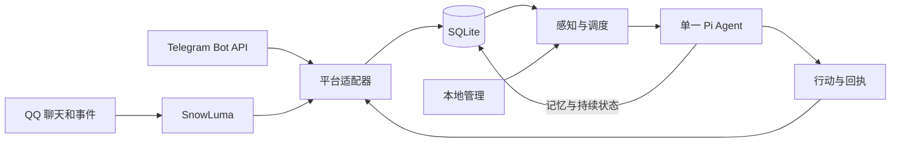

# 秋月·数字生命

基于 Pi Agent 构建的数字生命，拥有持续的人格与记忆。平台适配器将完整原生接口暴露为工具；同一个 Agent 感知 QQ、Telegram 等环境，自主决定何时参与、行动或保持沉默。

[English](README.md) | 简体中文

## 它能做什么

- **一个主体，多种对话。** 同一个 Agent 感知群聊、私聊等事件，保持统一的身份和记忆。
- **持续成长。** 经历、关系、正在进行的活动和行动结果保存在 SQLite 中，重启后可以恢复。
- **自主参与。** Agent 自己决定是否回应；开启自主生活后，还可以主动安排自己的活动。
- **本地管理。** 通过终端查看状态和记忆、暂停或恢复 Agent，并配置它可以使用的行动。

## 平台适配器

可同时接入具名的 SnowLuma 和 Telegram 适配器，也可独立使用 Telegram，无需运行 SnowLuma 服务或准备其接口目录。所有已启用的原生接口都作为独立工具交给同一个 Agent。已有 QQ 安装需要停机迁移。[配置、迁移、覆盖范围与适配器 SDK](docs/platform-adapters.md)说明了用法；NapCat 和 Discord 的正式适配器尚未包含在本次实现中。

已有安装请先停止常驻进程和管理网页，再执行 `npm run dev -- identities migrate --config config.json`。命令先备份，再迁移配置和数据库；旧工作上下文归档后重建。用户插件需升级到 `apiVersion: 2`。详细步骤和回退方法见[停机迁移说明](docs/platform-adapters.md#offline-upgrade)。

## 快速开始

### 1. 准备环境

本项目原创代码采用 MIT 许可。SnowLuma 适配器通过 npm 依赖使用官方 SDK，SDK 和接口目录保留各自的上游许可。SnowLuma 服务端由用户另行安装和运行。来源与分发条款见[第三方许可说明](THIRD_PARTY_NOTICES.md)。

安装 Node.js **24.22.1**（见 [`.nvmrc`](.nvmrc)），然后安装依赖：

```bash
nvm install
nvm use
npm ci
npm run sync:snowluma
```

同步命令将固定版本的接口目录及其许可保存到 Git 忽略的 `.qiuyue-cache/snowluma/`。SDK 或目录源码版本变化后需要重新同步。开发命令、测试和编译后的程序读取这个本地目录；也可用 `QIUYUE_SNOWLUMA_CATALOG` 指定另行准备的目录文件。构建产物不会包含它。

另行启动并登录 [SnowLuma](https://snowluma.github.io/en/docs/sdk)，启用正向 OneBot WebSocket 服务。你还需要支持图片输入的模型及其凭据。

### 2. 配置数字生命

```bash
cp config.example.json config.json
cp persona.example.md persona.md
install -m 600 credentials.example.json credentials.json
npm run dev -- models openai
```

查看其他服务商的模型时，将 `openai` 替换为对应的服务商名称。然后编辑：

- **`config.json`：** 设置 SnowLuma 地址，将 `adapters[0].accountId` 设为已登录 QQ 账号的十进制字符串，并将 `model.provider` 和 `model.id` 设为支持图片输入的模型。将 `personaFile` 改为 `persona.md`。`adapters[0].groups` 指定连接或恢复时需要补查历史消息的群，可为空，不限制实时事件的接收范围。
- **`config.json` 中的 `model.thinkingLevel`（可选）：** 推理模型每轮思考的强度：`off`（默认）、`minimal`、`low`、`medium`、`high`、`xhigh` 或 `max`。自定义模型还需将 `model.reasoning` 设为 `true`。强度如何发送由 `model.compat.thinkingFormat` 决定，请使用接口接受的格式，网关可能拒绝其他格式。使用 OpenAI 格式时，`off` 不发送任何参数，模型按自身默认强度思考；想尽量少思考请用 `minimal`。
- **`config.json` 中的 `embedding`（可选）：** 如需让数字生命按大家正在聊的内容想起记忆，将 `enabled` 设为 `true`，并把 `baseUrl` 和 `model` 指向兼容 OpenAI 的 embeddings 接口。各个阈值都取决于模型：`threshold`（消息让它想起什么）、`searchThreshold`（主动 `recall` 时的几个关键词，得分通常更低）和 `stickerThreshold`（描述与大家所说相符的已存表情，最多 `stickerLimit` 个）分别按 `qwen3-vl-embedding` 校准为 `0.65`、`0.55` 和 `0.65`，其他模型需要自行校准。在 `selfNames` 中列出别人对数字生命的称呼，避免一条消息因为提到它就匹配上所有提到它的记忆。不启用时，思考不会自动想起记忆，主动调用 `recall` 只按原词检索。
- **`config.json` 中的 `drawing`（可选）：** 如需让数字生命通过 `imagen` 生成图片（包括写实照片、插画、表情包和示意图），将 `enabled` 设为 `true`，并把 `baseUrl` 和 `model` 指向兼容 OpenAI 的 `/images/generations` 接口（例如提供 `gpt-image-2.5` 的网关），凭据名称由 `apiKeyEnv` 指定。生成一张图要半分钟以上，完成后会作为一条观察回到数字生命那里；请求超过 `timeoutMs` 即放弃。生成的图片保存在 `dir`（默认是配置文件旁的 `data/drawings`），由作品库长期保存，不随聊天记忆过期清理。生成次数不设上限，请自行留意接口额度。
- **`config.json` 中的 `life`：** `enabled` 决定首次启动时是否开启自主生活，`allowFiction` 允许虚构日常。自主生活开启时，`freeTime` 会在聊天安静一段时间（每次在 `quietMinMs` 到 `quietMaxMs` 之间随机）后提供一次 life wake，与其他 life wake 至少相隔 `gapMs`，每天最多 `perDay` 次。数字生命在安排醒来要做的活动时标记 rest，就能让它在那之前不来。
- **`persona.md`：** 描述数字生命的身份、世界观、性格和初始偏好。[示例人设](persona.example.md) 提供可逐段删改的完整角色，以及常见表达和相处习惯的写法。这些是可发展的初始倾向，不是所有人物都必须遵守的表达模板；平台活动和使用说明由插件提供，不必写进人设。
- **`credentials.json`：** 在 `credentials` 对象中填写 `MODEL_API_KEY`、SnowLuma 所需的 `SNOWLUMA_TOKEN`，以及联网搜索用的 `DEEPSEEK_API_KEY`、管理网页用的 `WEBUI_TOKEN`；保留示例中的 `version` 和 `changes`。`credentialsFile` 默认指向配置旁的 `credentials.json`，可设为绝对路径放在仓库外。文件仍是明文，以 `0600` 权限保护。读取顺序为：外部环境变量 → 凭据文件；空的外部变量或文件中的 `null` 会停用该凭据。`apiKeyEnv`、`tokenEnv`、`searchKeyEnv` 字段是凭据名称。程序不再读取 `.env`。中文界面请在 `config.json` 设置 `uiLanguage: "zh"`，修改后重启常驻进程和查看界面。

> **启动前请注意：** 示例配置开放了全部 SnowLuma 接口，且不限制模型调用和行动次数。请根据需要调整 `adapters[0].tools` 和 `limits`。自主生活默认关闭，可单独开启。

### 主思考、复盘与压缩模型

`model` 负责日常思考与行动。可选的 `review.model` 和 `compaction.model` 接受同样的完整模型配置，包括自定义端点能力、凭据名称和思考强度。例如，把较便宜的模型放在 `model`，再将强模型的完整配置分别复制到 `review.model` 和 `compaction.model`。三个用途都须支持图片输入，共享同一人格、长期记忆和持续状态。

不设置 `review.model` 时，复盘跟随主模型。不设置 `compaction.model` 时，各自使用所属上下文的模型生成摘要；显式设置后，主思考与复盘都由该模型压缩。删除 override 表示跟随，空模型对象或 `null` 无效。独立配置不会与其他模型逐字段合并，请求失败也不会自动切换模型。跟随模式下的摘要请求不主动开启额外推理；独立压缩模型使用自己的 `thinkingLevel`，默认 off。

复盘可独立设置 `review.limits.contextTokens` 和 `review.limits.outputReserveTokens`，未设置的字段跟随 `limits`。`compaction.contextTokens` 限制摘要请求窗口，默认跟随所属上下文的窗口配置，并受摘要模型实际窗口限制；`compaction.summaryMaxTokens` 限制包含来源引用的摘要长度。即使摘要模型窗口更大，结果仍必须放得回原上下文。校验命令会列出模型分配、缺少的凭据和不足的预算。输出预留包含推理量；Anthropic 按预算推理需要超过 1,024 tokens 的输出空间。

管理页的「模型」支持三种用途、继承开关、预算和连接测试。修改后重启生效；只改复盘或压缩设置会保留主工作上下文，修改 `model` 会新建工作上下文，记忆和持续状态保留。「状态总览 → 模型用量」分别展示最近 24 小时主思考、复盘及两者压缩的用量。所有尝试共用每日调用上限，每次重试只计一次。缺少的用量和旧记录的用途标为未知，SDK 中的零费用不代表免费。

### 3. 启动与查看

```bash
npm run dev -- validate --config config.json
npm run build
npm start -- run --config config.json
```

校验会检查配置、模型和凭据，不会连接 QQ。另开一个终端，进入实时界面：

```bash
npm start -- tui --config config.json
```

退出实时界面不会停止常驻进程。

实时界面默认以交流为主：收到的消息和秋月的对外行动在一轮结束后仍然可见，工具过程与模型输出按需展开。模型输出标明“未发送到 QQ”，消息行动分别显示已发送、等待远端回执、失败或结果未知。长正文默认预览八行，可展开全文。顶部显示连接与暂停状态，底部显示当前步骤耗时和上下文用量；配色适应终端的浅色、深色背景。新收到但尚未进入模型的事件放在待纳入区域。超过两分钟没有新输出会提示“等待较久”，这不代表已经确认卡住。

用 `Alt↑↓` 选择记录、`Tab` 展开详情，或用 `/details` 查看完整记录和流式进度；`/filter errors` 查看失败和结果未知的记录，`/filter all` 清除筛选。输入 `/` 浏览管理命令，用 `↑↓` 选择、`Tab` 补全，再按回车执行；`Esc` 关闭候选列表并保留输入。`/status` 查看调用与行动统计，`Esc` 关闭状态或帮助。更新后重新构建并重开 TUI 即可使用新布局；常驻进程更新后会额外提供结构化的发送者与行动类型。

## 日常管理

B 站与小红书可作为自主生活中的浏览活动：搜索、阅读、小红书图文一起看、平台原生收藏，并延续之前的阅读进度。两个平台都是独立的可选用户插件，需先单独构建并安装，默认关闭；安装后可在管理页分别配置和重载；B 站收藏与部分内容需要已登录的 Cookie，小红书需要已登录的 `xiaohongshu-mcp` 服务。设置与能力范围见[外部线上生活](docs/online-life.md)。

构建后，使用 `npm start -- <命令> --config config.json` 执行以下命令：

| 命令 | 用途 |
| --- | --- |
| `status` / `logs` | 查看持续状态或运行记录 |
| `pause` / `resume` | 暂停或恢复数字生命 |
| `life on` / `life off` | 开启或关闭自主生活 |
| `memory search <查询>` | 搜索记忆和个人笔记 |
| `memory show <ID>` | 查看记忆及其来源 |

执行 `npm start -- help` 可查看全部命令，包括记忆修正和删除。修改核心配置后需重启常驻进程。

### 管理网页

```bash
npm start -- webui --config config.json
```

用网页完成同样的管理：实时状态和时间线、暂停与自主生活开关、配置、插件与 QQ 接口权限、人格文件与数字生命自己的发展、系统提示词、模型供应商，以及单独存储的凭据。它独立于常驻进程运行，常驻进程重启时网页不断开；配置无法加载时也能打开网页修复。

- **访问：** 监听 `webui.host`:`webui.port`（默认 `127.0.0.1:8848`）；从其他机器访问请用 SSH 隧道，例如 `ssh -L 8848:127.0.0.1:8848 <服务器>`。将 `webui.tokenEnv` 指定的凭据值（默认名称 `WEBUI_TOKEN`）粘贴到登录框；凭据名称本身不是令牌。如果未配置令牌，每次启动会在终端或服务日志中打印临时令牌，将它粘贴到登录框即可。URL 查询参数中的令牌不再用于登录。
- **界面：** 六个主标签页按活动、配置、能力、人格、提示词和模型分区。右上角「主题色」支持六组预设、自定义 HEX，以及浅色、深色、跟随系统；偏好自动保存在当前浏览器，立即生效，无需重启。配置中的时间可切换毫秒、秒、分钟、小时显示，保存时统一换算为毫秒。
- **保存：** 每次保存都按常驻进程的方式校验配置；如果文件在网页读取后被其他地方改过，会拒绝保存；配置、人格和提示词的历史版本保存在 `data/webui/history`。凭据不保存旧值，只在凭据文件中记录最近 100 次变更的名称、时间和操作。插件设置可在能力页通过重载应用，核心设置仍在重启后生效。网页显示实际插件版本与重载结果，并提示是否延续工作上下文：修改人格、系统提示词、模型或工具集会让工作上下文重新开始。
- **系统提示词：** 保存时写入 `config.json` 旁的 `system-prompt.md`（不在 git 中），并设置 `systemPromptFile`；不设置时使用内置提示词。内置提示词在你保存之后有更新时，网页会提示。
- **重启：** 把 `webui.service` 设为常驻进程的 systemd 用户服务名（例如 `qiuyue-digital-life.service`），就能在网页上启动、停止和重启它。重启可以等到没有思考和记忆整理在进行时再执行。
- **凭据：** 网页展示掩码和来源，外部环境提供的凭据只读，新值只写入 `credentialsFile`。连接测试按与常驻进程相同的优先级读取最新文件；插件凭据可通过重载对应插件生效，核心模块的凭据仍需重启常驻进程，修改网页登录令牌还需重启管理网页。
- **供应商：** 网页把供应商端点保存在 `data/webui/providers.json`；选用某个供应商时，会把它的地址、API 和密钥变量复制到当前选择的主思考、复盘、压缩模型，或 `embedding`、`drawing`。常驻进程只读 `config.json`。

## 工作原理



TypeScript 服务在 Agent 思考期间持续接收事件。具名适配器按 `实例名__原生接口名` 暴露所有已开放接口；原生参数保持不变，可用范围由各账号的 `tools` 控制。Agent 可以使用 `qq_main__search_snowluma_tools` 搜索接口，并通过 `qq_main__load_snowluma_tools` 查看详细用法。

系统提示词统一使用 [`src/prompts/system.md`](src/prompts/system.md)，随运行时代码维护，与运营者的 `personaFile` 分开。提示词在启动时读取一次，`npm run build` 会将它复制到 `dist`。修改后重新构建并重启常驻进程；开发模式只需重启。

QQ 原生工具、图像生成（`imagen`）、网页搜索、网页阅读、空间卡片分享、收藏表情增强和 QQ 系统表情通过插件接入。插件可以提供工具，也可以增强已有工具，并附加观察提示、后台任务和图片。现有 `drawing`、`web` 配置继续有效；可以在 `config.json` 中增加独立开关，例如：

```json
"plugins": {
  "web-search": false,
  "web-reader": true,
  "qq-main-qzone-share": true,
  "qq-main-qq-stickers": true,
  "qq-main-qq-faces": true,
  "qq-main-snowluma-tools": true
}
```

省略开关时保持原有行为。`drawing` 插件还需开启 `drawing.enabled`，搜索和阅读还需开启 `web.enabled`；空间分享仍受 `adapters[0].tools` 的接口权限限制。具名 QQ 插件及账号权限修改后需重启；普通插件保存配置后，在能力页点击“重载插件”，或执行 `npm run dev -- plugins reload all --config config.json`。用户插件放在配置旁的 `plugins/<id>/index.mjs`，执行 `plugins reload <id>` 即可加载，无需修改秋月源码。`plugins list` 显示实际运行版本和待应用修改。公开接口与生命周期约定见[插件说明](docs/plugins.md)和[时钟示例](examples/plugins/clock/index.mjs)。

`qq-main-qq-stickers` 默认开启，负责收藏时附带描述、识别已收藏图片，以及根据聊天内容推荐表情。推荐复用 `embedding` 的消息向量，阈值和数量仍由 `embedding.stickerThreshold`、`embedding.stickerLimit` 控制；不开 embedding 也能使用其余增强。设为 `false` 会关闭这些增强和表情索引，原生收藏、描述、删除和发送接口继续按权限开放，已有收藏记录与向量保留。

`qq-main-qq-faces` 默认开启，提供 `view_face`、系统表情名称、图片缓存，以及观察中的自动补图。同一轮只自动展示每种表情一次，补图排在聊天图片之后，并遵守统一的图片与上下文限制。设为 `false` 会关闭名称增强、补图和 `view_face`；聊天记录继续显示原始编号，原生回应和发送接口仍按权限开放，已有目录缓存保留。

`qq-main-snowluma-tools` 默认开启，负责 QQ 原生工具注册、搜索与详细用法，以及空间、群相册、签到、资料修改等自主活动提示。可用原生工具继续由 `adapters[0].tools.allow`、`deny` 控制。设为 `false` 会移除这组工具和提示；同时停止该账号的连接、感知和原生调用，记忆保留。收藏表情的发送建议会随原生工具一起停止。

领域术语和设计决定见[术语表](GLOSSARY.md)与[架构决策记录](docs/adr/)。

## 思路参考与感谢

感谢以下项目及其贡献者提供的思路与设计参考，相关调研记录见 [research 目录](docs/research/)：

- [Letta / MemGPT](https://github.com/letta-ai/letta) 与 [Letta Code](https://github.com/letta-ai/letta-code)：外部记忆、记忆整理与上下文压缩。
- [Koishi](https://github.com/koishijs/koishi)：插件组合与生命周期、配置 Schema、平台适配器和测试工具。
- [Pi](https://github.com/earendil-works/pi)：本项目使用的嵌入式 Agent 运行时，以及工具接口与按需加载技能的设计。
- [OpenClaw](https://github.com/openclaw/openclaw)：分层记忆、压缩前保存记忆与技能组织。
- [Generative Agents](https://arxiv.org/abs/2304.03442)：基于经历的反思、记忆重要性与持续计划。
- [Mem0](https://github.com/mem0ai/mem0)、[Graphiti](https://github.com/getzep/graphiti) 与 [Hindsight](https://github.com/vectorize-io/hindsight)：记忆组织、混合检索与经历之间的关联。
- [MaiBot](https://github.com/MaiM-with-u/MaiBot) 与 [AstrBot](https://docs.astrbot.app/use/skills.html)：表情资源、社交工具使用，以及技能与插件的职责划分。
- [Aurabot](https://github.com/aureth-labs/dsh-aurabot-qq) 与 [qq-bridge](https://github.com/Derpyu520/qq-bridge)：聊天表达、主动参与、线上活动与插件设计。
- [DeepSeek Harness](https://github.com/deepseek-ai/deepseek-harness)：Token 预算、工具结果裁剪与上下文压缩。

## 参与贡献

提交 Issue 或 PR 前，请阅读[贡献指南](CONTRIBUTING.md)，了解问题描述、本地验证和审核规则。欢迎使用中文或英文参与。

## 许可证

本项目原创代码采用 [MIT](LICENSE) 许可。SnowLuma SDK 和本地准备的接口目录保留各自的[上游许可](THIRD_PARTY_NOTICES.md)。

### 作品库

管理页面的「作品库」展示自己生成的图片，支持搜索、日期/来源/标签筛选、收藏、归档、下载和删除。生成成功即保存原图和创作信息，不依赖发送成功；关闭绘画接口后仍可使用旧作。`gallery` 是默认开启、可单独重载的内置插件。模型使用 `search_drawings` 查找、`view_drawing` 看图、`update_drawing` 整理，再把原来的 `drawing:<uuid>` 交给发送、空间或表情工具。提示词与实际画面描述分开记录，语义检索复用 embedding，接口不可用时回退关键词。

图库条目以目录记录为准。启动时恢复已跟踪的中断生成任务和未完成的删除操作，不再导入旧事件或未登记的图片文件；已有目录记录和原图继续可用。归档可恢复；删除会永久清除图片、缩略图和搜索索引，并在历史中保留已删除状态。服务停止时仍可浏览和下载，修改需要服务和 `gallery` 插件运行。`plugins.gallery: false` 停用图库工具和索引，不删除作品。新增内置代码需要重新构建并重启一次，之后可用 `plugins reload gallery` 应用插件开关。
