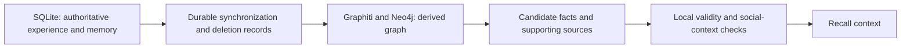

# Graph memory alternatives and engine selection

Reviewed: 2026-11-02. This investigation examined the authors' papers, official repositories, and official documentation. None of these systems was deployed, and no comparative product benchmark used Qiuyue's real group chats. Paper results describe particular experiments and do not directly establish the benefits of migrating Qiuyue. See the [earlier investigation](memory-system-options.md) for the context of a wholesale migration. Capabilities and recommendations below are a dated research snapshot, not a freshly verified product assessment.

## Follow-up selection — 2026-11-05

The user clarified that the immediate goal is a locally deployable graph engine for the previously discussed associative memory. **Start with Graphiti plus local Neo4j as a derived temporal relationship index; keep Hindsight as the main comparison candidate.** This is an architectural fit judgment, not a measured recall winner or an accepted implementation decision. The original investigation below remains a dated snapshot; this section records the new checks.

### Candidate order for this project

| Candidate | Current evidence | Recommendation for Qiuyue |
| --- | --- | --- |
| Graphiti | Explicit entities, relation edges, supporting episodes, fact validity and invalidation times; custom entity/edge schemas | First experiment when adding a relationship layer to the existing Memory model |
| Hindsight | Fact extraction, graph and temporal retrieval, automatic consolidation; PostgreSQL stores both vectors and graph connections | Main comparison, particularly if evaluating a broader replacement of extraction and recall |
| Cognee | Relational provenance, vector retrieval, customizable entity-relation graphs and ingestion pipelines | Reconsider first when organizing mixed documents and knowledge around a custom ontology becomes the priority |

Graphiti sources: [overview](https://help.getzep.com/graphiti/getting-started/overview), [custom types](https://help.getzep.com/graphiti/core-concepts/custom-entity-and-edge-types). Hindsight sources: [retain](https://hindsight.vectorize.io/developer/retain), [recall](https://hindsight.vectorize.io/developer/retrieval), [storage](https://hindsight.vectorize.io/developer/storage). Cognee sources: [architecture](https://docs.cognee.ai/core-concepts/architecture), [graph stores](https://docs.cognee.ai/setup-configuration/graph-stores). Hindsight and Cognee can also be used incrementally; this ordering does not imply that either requires a wholesale migration.

The reason to start with Graphiti is that Qiuyue already owns memory formation, development, continuing state, provenance, and revision. Its immediate gap is navigating explicit relationships and their changes. Graphiti exposes this layer directly. For example, a test can ask how the Agent came to know someone through two introductions, or which relationship held before a later correction. Temporal fields make these questions representable; extraction and retrieval accuracy still need testing.

### What a local deployment would contain

Use a small Python service embedding `graphiti-core`, initially backed by Neo4j Community, with the current TypeScript process calling a narrow local API. Graphiti handles ingestion and retrieval; Neo4j stores the graph. The documented Neo4j route is the initial choice because it is the primary supported backend, not because this investigation measured it against alternatives. FalkorDB and embedded FalkorDB Lite are also available. Model extraction and embeddings need their own providers; hosting the graph locally does not by itself keep model processing local. The upstream REST/MCP servers are reference implementations and should not be assumed to supply production operation guarantees. [Neo4j configuration](https://help.getzep.com/graphiti/configuration/neo4j-configuration), [pinned README](https://github.com/getzep/graphiti/blob/fb60e59d4a208c99e7d0186ee6335d2a257f17f2/README.md), [REST reference](https://github.com/getzep/graphiti/blob/fb60e59d4a208c99e7d0186ee6335d2a257f17f2/server/README.md)

This extends the replaceable retrieval direction in [ADR-0009](../adr/0009-embedded-pi-with-local-state-and-cli.md). Activities, commitments, habits, practices, and impressions retain their direct delivery paths under [ADR-0006](../adr/0006-experience-understanding-and-continuing-state.md) and [ADR-0012](../adr/0012-self-maintained-development-alongside-the-operator-persona.md); they do not become optional graph hits. Graph-generated summaries are not automatically promoted into the Agent's long-term understanding.

### Source checks that affect integration

The source recheck examined upstream main `fb60e59d4a208c99e7d0186ee6335d2a257f17f2`, dated 2026-11-03. This is not an installed or validated release.

- `EntityEdge` records supporting episodes and fields including `valid_at`, `invalid_at`, and `expired_at`. Episodic nodes preserve source content and reference time. These support provenance and temporal representation, but do not verify the truth of extracted relationships. [edges.py](https://github.com/getzep/graphiti/blob/fb60e59d4a208c99e7d0186ee6335d2a257f17f2/graphiti_core/edges.py#L263), [nodes.py](https://github.com/getzep/graphiti/blob/fb60e59d4a208c99e7d0186ee6335d2a257f17f2/graphiti_core/nodes.py#L318)
- Keep an application-owned map from canonical person/event/memory IDs to graph UUIDs. Supplying an ontology or a UUID is not sufficient to guarantee identity or idempotency: `add_triplet` still resolves missing entities, while `add_episode(uuid=...)` looks up an existing episode. One graph namespace should not automatically mean one QQ group. [triplet and episode handling](https://github.com/getzep/graphiti/blob/fb60e59d4a208c99e7d0186ee6335d2a257f17f2/graphiti_core/graphiti.py#L1447), [namespacing](https://help.getzep.com/graphiti/core-concepts/graph-namespacing)
- `remove_episode` preserves facts with remaining sources and attempts to rebuild surviving entity summaries. On summary-rebuild failure, however, it restores the old summary and logs the error. A successful removal call alone therefore does not prove that deleted content cannot be recalled. The inspected routine also does not establish restoration of earlier facts invalidated by the removed episode or rebuilding of every aggregate summary. These latter limits are static-review inferences, not reproduced runtime failures. [removal implementation](https://github.com/getzep/graphiti/blob/fb60e59d4a208c99e7d0186ee6335d2a257f17f2/graphiti_core/graphiti.py#L2174)

These are reasons to keep the graph rebuildable and gate returned evidence against local state. Explicit deletion must also clean the graph itself; filtering its output is not a substitute for deletion. If an affected projection cannot be verified, withhold it and rebuild from allowed surviving sources. Graph writes need reconciliation after timeouts rather than blind retries. [ADR-0003](../adr/0003-separate-runtime-control-from-social-requests.md), [ADR-0008](../adr/0008-preserve-unknown-action-outcomes.md)

### First evaluation

Use the same synthetic or sanitized material for the current retrieval baseline and Graphiti. Cover cross-group identity and aliases, two-hop associations, historical validity, conflicting first-hand and third-party reports, fictional versus actual experience, deletion with multiple supporting sources, deletion during ingestion, and summary-rebuild failure. Check evidence, incorrect associations, stale results, p95 latency, model calls, and cost under the same context budget. Start with deliberate recall; spontaneous recall currently uses local precomputed vectors and must not acquire an unbounded remote wait.

Only after these cases pass should a production recall path use the graph. Hindsight is the next comparison if Graphiti does not improve associative recall or its integration cost outweighs the gain. No services were deployed, no data was migrated, and no runtime code was changed during this follow-up. Documentation-only changes did not require rerunning application tests.

## Distinguishing graph mechanisms

| Type | What nodes and edges represent | Problems it can address | Examples examined |
| --- | --- | --- | --- |
| Entity-relation and temporal knowledge graphs | People, organizations, and other entities, with sourced and time-qualified relationships | Identifying the same person across experiences, multi-hop relationships, and relationship changes | Graphiti; Hindsight also includes facts, entities, and several association types |
| Linked memory notes | Semantic and topical links between complete memory notes | Associating one experience with another and progressively revising understanding | A-MEM |
| Multiple relationship views | Semantic, temporal, causal, and entity connections over the same events | Selecting paths according to who, when, or why a query concerns | MAGMA; Hindsight also has multiple connection types |
| Document knowledge graphs | Entities, relationships, communities, and summaries extracted from documents | Local or global questions over a long-lived document collection | LightRAG and Microsoft GraphRAG, discussed below |

A graph is a retrieval and organization structure; it does not necessarily require a dedicated graph database. A "multi-graph" approach may retain different edge types in one graph and select views according to the query. The word "Graph" in a product name is not evidence of an equivalent implementation.

## Hindsight: a candidate for a complete memory service

**Graph structure.** `retain` extracts facts from material and distinguishes external `world` facts from the `experience` of the Agent owning the bank. Speaker context must be clear for person identification. Memories are linked by shared entities, temporal proximity, semantic similarity, and causality, rather than merely converting statements such as "someone likes something" into triples. [Retain](https://hindsight.vectorize.io/developer/retain) The examined source creates temporal, semantic, and causal edges; causal writes use `caused_by` while remaining compatible with historical edge types. [link_creation.py](https://github.com/vectorize-io/hindsight/blob/6301f8ce9d68477316caa905d60f207c906752e3/hindsight-api-slim/hindsight_api/engine/retain/link_creation.py)

**Retrieval.** `recall` combines semantic matching, keywords, graph associations, and time windows, then reranks the fused results and fits them to a token budget. It can return source chunks. Temporal retrieval parses time expressions in questions into windows rather than merely sorting by write time. [Recall](https://hindsight.vectorize.io/developer/retrieval) This makes it a useful comparison candidate for Graphiti, but does not establish equivalent temporal semantics or performance.

**Understanding and provenance.** The official terminology at the review date distinguished basic `world` / `experience` facts, automatically consolidated `observations`, and `mental models` maintained for specified questions. Older material referring to opinions should not be treated as the current unified classification. Observations retain supporting memories, citations, and change history. [Observations](https://hindsight.vectorize.io/developer/observations) For a mental model, the application selects a recurring question and the system maintains its answer, sources, and versions. [Mental models](https://hindsight.vectorize.io/developer/mental-models)

`reflect` is a separate Agent reasoning loop that collects evidence and uses the bank's disposition; it is not another name for `recall`. [Reflect](https://hindsight.vectorize.io/developer/reflect) **Inference for Qiuyue:** Its sourced understanding and layered retrieval are useful references, but letting it form long-term understanding on Qiuyue's behalf would require aligning its behavior with this project's identity and evidence rules. An initial experiment could use only `retain` / `recall`, preserving Qiuyue's own judgments, or disable default automatic consolidation and control its timing.

**Operational boundaries.** The service primarily uses PostgreSQL + pgvector. Graph queries also run in SQL, without requiring Neo4j. Development mode can start embedded pg0, while the production documentation describes self-managed PostgreSQL. Oracle is another enterprise deployment option. [Storage](https://hindsight.vectorize.io/developer/storage) The official `@vectorize-io/hindsight-client` TypeScript client connects to the Hindsight API; core extraction and consolidation still run on the server. [TypeScript client](https://github.com/vectorize-io/hindsight/blob/6301f8ce9d68477316caa905d60f207c906752e3/hindsight-clients/typescript/README.md) The repository uses the MIT license. [LICENSE](https://github.com/vectorize-io/hindsight/blob/6301f8ce9d68477316caa905d60f207c906752e3/LICENSE)

**Position:** Suitable for engineering experiments alongside Graphiti. Having a deployment model and SDK does not establish that cross-group scope, forgetting propagation, or identity merging meet Qiuyue's requirements. In particular, the project should supply stable identities for nicknames and QQ IDs rather than relying entirely on fuzzy name matching.

## A-MEM: association and evolution between notes

The authors explicitly adopt a Zettelkasten approach: each memory is a note with content, context, keywords, and tags. The system first retrieves related old notes, then uses an LLM to create links and potentially update those notes' context and attributes. This is a **graph of associations between memory notes**, distinct from Graphiti's temporal entity-relation graph. [A-MEM paper](https://arxiv.org/abs/2502.12110)

The paper's links distinguish the reusable system `agiresearch/A-mem` from the reproduction experiments in `WujiangXu/AgenticMemory`; this investigation focused on the former. The system uses Python, ChromaDB, Sentence Transformers, and OpenAI/Ollama LLMs. Its source includes `MemoryNote.links`, update logic, and neighbor expansion. [Official repository](https://github.com/agiresearch/A-mem), [memory_system.py](https://github.com/agiresearch/A-mem/blob/ceffb860f0712bbae97b184d440df62bc910ca8d/agentic_memory/memory_system.py)

The default `AgenticMemorySystem` retains an in-memory dictionary and initializes a regular Chroma client; a persistent retriever is provided separately in the source. The README's description of persistence alone therefore does not establish complete restart recovery in the default configuration. [retrievers.py](https://github.com/agiresearch/A-mem/blob/ceffb860f0712bbae97b184d440df62bc910ca8d/agentic_memory/retrievers.py) The main repository is an MIT-licensed research library. This review did not find a production interface on which to base commitments about availability, complete provenance auditing, group scope, or deletion propagation. [LICENSE](https://github.com/agiresearch/A-mem/blob/ceffb860f0712bbae97b184d440df62bc910ca8d/LICENSE)

**Position:** Primarily a reference for linking experience notes and letting new experiences trigger review of earlier understanding. Links must distinguish similarity or relevance from evidential support and causality; ordinary relatedness cannot directly serve as this project's source evidence. Third-party TypeScript reimplementations should not be mistaken for the authors' official library.

## MAGMA: choosing temporal, causal, semantic, and entity paths by question

The examined work is Dongming Jiang et al.'s **MAGMA: A Multi-Graph based Agentic Memory Architecture for AI Agents**. The authors' paper links to `FredJiang0324/MAGMA`; this is distinct from Microsoft's multimodal model with the same name. The paper proposes four relationship views—semantic, temporal, causal, and entity—selects traversal paths by query intent, and separates fast writes from slower structural consolidation. [Paper](https://arxiv.org/abs/2601.03236), [Authors' repository](https://github.com/FredJiang0324/MAGMA)

**An implementation exists.** The repository contains event, episode, narrative, and entity nodes; `TEMPORAL`, `SEMANTIC`, `CAUSAL`, and `ENTITY` edge types; and traversal constraints. Its actual backend is a NetworkX `MultiDiGraph` with JSON save/load support. Vector retrieval uses FAISS and other Python dependencies; it is not a delivered Neo4j service. [graph_db.py](https://github.com/FredJiang0324/MAGMA/blob/467cb70b67ac337b22fdb42194d37c04ad701b62/memory/graph_db.py), [requirements.txt](https://github.com/FredJiang0324/MAGMA/blob/467cb70b67ac337b22fdb42194d37c04ad701b62/requirements.txt)

**The research design differs from the default path.** The query engine has code for selecting weights by WHY / WHEN / ENTITY intent and for adaptive traversal, but intent recognition relies heavily on English keyword rules. Direct use in Chinese group chats would require adaptation. [query_engine.py](https://github.com/FredJiang0324/MAGMA/blob/467cb70b67ac337b22fdb42194d37c04ad701b62/memory/query_engine.py)

Some "causal" edges in graph construction come from a `RESPONSE_TO` heuristic between adjacent turns by different speakers. Some shared-entity links are expressed through `SEMANTIC/SAME_ENTITY` paths. [memory_builder.py](https://github.com/FredJiang0324/MAGMA/blob/467cb70b67ac337b22fdb42194d37c04ad701b62/memory/memory_builder.py) The core also implements asynchronous causal inference, fast paths, and slow-path consolidation. [trg_memory.py](https://github.com/FredJiang0324/MAGMA/blob/467cb70b67ac337b22fdb42194d37c04ad701b62/memory/trg_memory.py) It would therefore be inaccurate to say that only a paper exists, but edge labels must not be treated as verified real-world causality.

The repository's main usage entry points are LoCoMo/LongMemEval evaluation scripts, and its license is MIT. The examined material supports treating it as a research implementation, not a production memory service. [README](https://github.com/FredJiang0324/MAGMA/blob/467cb70b67ac337b22fdb42194d37c04ad701b62/README.md), [LICENSE](https://github.com/FredJiang0324/MAGMA/blob/467cb70b67ac337b22fdb42194d37c04ad701b62/LICENSE)

**Position:** A useful design reference for following entity associations when asked about a person, temporal chains when asked when something happened, and traceable explanations when asked why. Importing its causal edges directly and having Qiuyue treat them as known facts would be inappropriate.

## Cognee

Cognee turns documents, code, and conversations into searchable knowledge graphs. Its architecture stores provenance and document metadata in relational storage, text representations in vector storage, and entity relationships in graph storage, combining semantic matching with graph structure during retrieval. [Architecture](https://docs.cognee.ai/core-concepts/architecture) At the review date, the main workflow was `remember` / `improve` / `recall`. The official companion example imports notes into the graph and uses `improve` after a session so later conversations can draw on earlier experiences. [Official repository](https://github.com/topoteretes/cognee), [Self-Hosted AI Companion](https://docs.cognee.ai/cookbooks/self-hosted-companion)

It supports custom graph models and OWL ontologies, organizing domain knowledge using application-defined entity types and relationships. Ontology grounding aligns and labels by default while retaining unmatched entities; it does not verify factual truth or source trustworthiness. [Ontology Quickstart](https://docs.cognee.ai/guides/ontology-support)

The open-source engine is primarily Python, with HTTP API and MCP interfaces. The reviewed official documentation also listed `@cognee/cognee-ts`, which exposes an interface to Node through native bindings to `cognee-rs`; describing it as integrable only through a Python service would be inaccurate. Whether interfaces have equivalent capabilities must still be checked against the chosen version. [Products and integration options](https://docs.cognee.ai/) The default graph backend was embedded Ladybug, compatible with legacy `kuzu` configuration. Backends such as Neo4j and Neptune have different operational requirements, and the built-in Postgres graph adapter is explicitly a demo. Lightweight default deployment must not be confused with production scalability. [Graph Stores](https://docs.cognee.ai/setup-configuration/graph-stores)

**Inference for Qiuyue:** It merits experiments alongside Graphiti and Hindsight, particularly for organizing chats, notes, and long-term understanding into customizable entity-relation networks. Its automatic consolidation must align with Qiuyue's own rules for forming understanding. Unified storage of different materials does not establish that cross-group sharing and revision propagation meet this project's requirements.

## LightRAG, Microsoft GraphRAG, and other document-association retrieval

**LightRAG** extracts entities and relationships from text, combines graph and vector representations, and organizes context through dual-level retrieval of low-level entities and high-level themes. The paper includes incremental updates, and the reviewed repository also supports selective document deletion and rebuilding affected entities and relationships. It is therefore inaccurate to describe it as limited to immutable static files. [Authors' paper](https://arxiv.org/abs/2410.05779), [Official repository](https://github.com/HKUDS/LightRAG) **Inference:** Useful for adding associative retrieval to a long-lived document collection, but this project must separately validate its fit for multi-person experiences, the validity periods of views, and memory development.

**Microsoft GraphRAG** typically extracts entities and relationships, detects communities, and summarizes those communities. Local search organizes evidence around relevant entities and original text, while global search uses community reports to synthesize themes across documents. [Indexing workflow](https://microsoft.github.io/graphrag/index/default_dataflow/), [Local Search](https://microsoft.github.io/graphrag/query/local_search/), [Global Search](https://microsoft.github.io/graphrag/query/global_search/) At the review date, the official README described the project as primarily in maintenance mode: appropriate fixes and dependency updates would continue, but new PRs and features were not accepted. It characterized the code as a research demonstration rather than a formally supported Microsoft product. [Project status source](https://github.com/microsoft/graphrag) **Inference:** Its aggregation of long-term group-chat themes is worth studying, but Microsoft's branding alone was not a reason to prioritize it as Qiuyue's continuing-memory core.

**HippoRAG 2** focuses more directly on associative memory. Using knowledge graphs and Personalized PageRank, it incorporates passages into graph structure and lets queries propagate from relevant nodes to other knowledge. The paper and authors' implementation mainly demonstrate cross-document, multi-hop, and integrated-understanding tasks. [Authors' paper](https://arxiv.org/abs/2502.14802), [Official implementation](https://github.com/OSU-NLP-Group/HippoRAG) **Inference:** Retrieval-time associative propagation is a useful reference, but the paper does not directly establish complete mechanisms for long-term social relationship revision, person identity, or forgetting.

## Implications for Qiuyue at the review date

Graphiti, Hindsight, and Cognee could be compared as engineering candidates; A-MEM and MAGMA were more useful as references for mechanisms. Candidate status does not imply that a wholesale migration is warranted or that these systems have equal maturity.

The most valuable first step for Qiuyue would be to add **retrieval relationships with explicit semantics** alongside the existing provenance and revision chains: for example, the same person, the same event, temporal adjacency, or related experiences. Causal inference, supporting evidence, and ordinary relatedness must remain distinct. Compare multi-hop queries and historical recall on copies of the existing authoritative SQLite records before deciding whether to replace the retrieval layer. [Domain requirements and migration constraints](memory-system-options.md)

Regardless of graph changes, continuing state must still be restored directly. Social scope, fictional status, source revision, and explicit forgetting remain this project's acceptance criteria; support for graph memory does not imply that they are satisfied. [ADR-0006](../adr/0006-experience-understanding-and-continuing-state.md), [ADR-0009](../adr/0009-embedded-pi-with-local-state-and-cli.md)

## Source snapshots examined

Key source links are pinned to default-branch commits examined in this investigation: Hindsight `6301f8ce9d68477316caa905d60f207c906752e3` (2026-11-02), A-MEM `ceffb860f0712bbae97b184d440df62bc910ca8d` (2025-12-12), and MAGMA `467cb70b67ac337b22fdb42194d37c04ad701b62` (2026-07-10). This identifies the source-review scope, not versions installed or successfully run here. Unpinned documentation and repository links may change; they preserve the original source locations rather than guaranteeing a reproducible snapshot.
